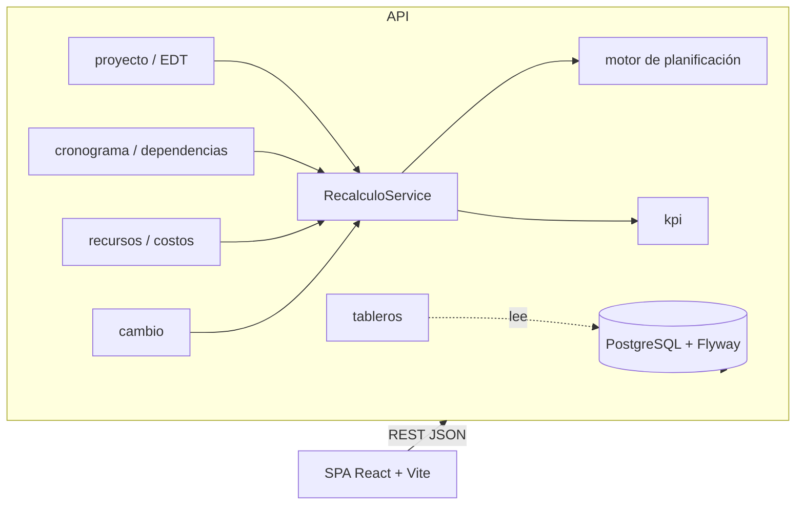

# Arquitectura

Monolito modular con un solo despliegue: SPA React → API REST (Spring Boot 3.5, Java 21) → PostgreSQL 16 con migraciones Flyway.

## Módulos del backend (`cl.proyecto.gestion`)

| Paquete | Responsabilidad | Dueño |
|---|---|---|
| `proyecto` | Proyectos y EDT: crear, editar, cerrar; árbol de 3 niveles con códigos automáticos, mover y renumerar | A |
| `planificacion.motor` | **Dominio puro** (sin base de datos ni Spring): calendario, validación de ciclos y cálculo de fechas con FS, SS, FF y SF | A |
| `planificacion.dependencia` | API de dependencias; rechaza ciclos y devuelve qué fechas se movieron | A |
| `planificacion.cronograma` | `PATCH /tareas/{id}`: duración, fechas reales y avance | A |
| `planificacion.recalculo` | `RecalculoService` y los pasos del recálculo | A |
| `planificacion.lineabase` | Fijar la línea base y comparar base / plan / real | A |
| `planificacion.calendario` | Días laborales y no laborables | A |
| recursos, costos, hitos, KPI | Asignaciones, costos, sobreasignación, hitos y KPI configurables, tablero de proyecto | B |
| cambio, auth, tableros | Solicitudes de cambio con 10 etapas, usuarios y roles, tablero de cambio | C |
| `common` | `ApiException` y manejo uniforme de errores `{codigo, mensaje, detalles}` | A |

Frontend (`frontend/src/features`): `proyectos` (listado, detalle, EDT en lista y esquema, dependencias), `gantt` (diagrama SVG), más las carpetas de los demás módulos. El cliente HTTP (`src/api/client.ts`) traduce los errores del backend a mensajes legibles.

## Flujo de recálculo (el corazón del sistema)

Cualquier modificación que afecte el plan termina en **un único punto**, `RecalculoService.recalcular(proyectoId)`. Corre en **una transacción**
y ejecuta los pasos registrados (`PasoRecalculo`), ordenados por `OrdenRecalculo`:

| Orden | Paso | Qué hace | Dueño |
|---|---|---|---|
| 10 | `MOTOR_FECHAS` | Dependencias y duraciones → fechas plan de las tareas sin hijos | A |
| 20 | `CONSOLIDACION` | Avance, fechas y duración hacia actividades, etapas y proyecto | A |
| 30 | `COSTOS` | Costo plan y real por asignación y tarea | B |
| 35 | `CONSOLIDACION_COSTOS` | Suma de costos de las hojas hacia etapas y proyecto, sin duplicar | A |
| 40 | `SOBREASIGNACION` | Alertas de profesionales sobreasignados | B |
| 50 | `HITOS` | Estado y fechas de los hitos | B |
| 60 | `KPI` | Evalúa los KPI y guarda el histórico | B |

Si un paso falla, se deshace todo: un error de negocio (`ApiException`) se devuelve tal cual, un ciclo responde `409 CICLO_EN_DEPENDENCIAS` y
cualquier otro error responde `500 RECALCULO_FALLIDO`. Los tableros no recalculan nada: solo leen lo ya calculado.

**Quién dispara el recálculo (los 3 de la demo)**
1. **Cambiar una duración** → `PATCH /api/tareas/{id}` (desde el panel del Gantt) → recálculo → se mueven las sucesoras y se actualizan costos y KPI.
2. **Modificar recursos** → módulo de recursos (B) → recálculo → costos, sobreasignación y KPI.
3. **Aprobar una solicitud de cambio** → módulo de cambio (C) → aplica el impacto al plan → recálculo; la línea base se conserva.

## Reglas del motor de planificación
Detalle en `docs/gestion/decisiones/ADR-002` (semántica) y `ADR-003` (consolidación). En resumen:
- Duraciones en días hábiles, fin inclusivo (`fin = inicio + duración − 1`); duración 0 es un hito.
- FS: la sucesora empieza después de que termina la predecesora (+ desfase); SS: respecto del inicio; FF y SF: restringen el fin de la sucesora. Gana la restricción más exigente, y nada empieza antes del inicio del proyecto.
- Padres: avance = promedio ponderado por duración de los hijos; fechas = mínimo y máximo de los hijos; costos = suma de las hojas.
- La línea base copia el plan vigente (`*_base`); después solo cambia el plan, y la comparación mide desviaciones en días hábiles (positivo = más tarde).

## Contratos de la API
`docs/api/proyectos-edt.md`, `docs/api/planificacion.md` y `docs/api/linea-base.md`. Todos los errores tienen la forma `{ "codigo", "mensaje", "detalles" }`.

## Reglas de dependencia entre módulos
- `planificacion/motor` es dominio puro: no importa base de datos ni otros módulos.
- Los módulos no se llaman entre sí para recalcular: todos invocan `RecalculoService`, y cada uno aporta su `PasoRecalculo`.
- Los KPI se calculan con una fórmula en texto sobre un catálogo de variables; no hay lógica de KPI duplicada.
- Una migración publicada no se edita: se agrega otra.

## Decisiones de diseño (ADR)
`docs/gestion/decisiones/`: ADR-002 semántica de dependencias, ADR-003 consolidación, ADR-004 alineación con la guía del profesor, ADR-005 Gantt propio en SVG.
