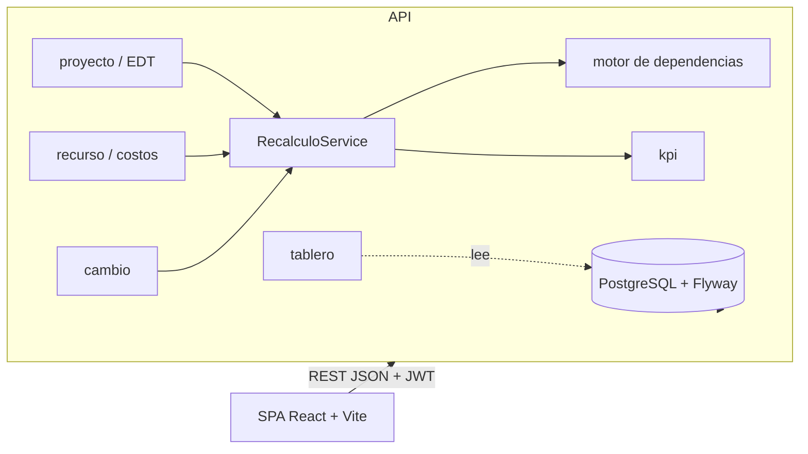

# Arquitectura

Monolito modular, un solo despliegue: SPA React -> API REST (Spring Boot) -> PostgreSQL.

## Flujo de recálculo (corazón del sistema)

Cualquier modificación (cambiar una duración, modificar recursos, aprobar una solicitud) termina en
`RecalculoService.recalcular(proyectoId)`, que ejecuta en **una transacción** los pasos registrados
(`PasoRecalculo`, ordenados por `OrdenRecalculo`):

1. `MOTOR_FECHAS` (A): dependencias -> fechas plan de las tareas hoja
2. `CONSOLIDACION` (A): avance, fechas y costos hacia etapas y proyecto
3. `COSTOS` (B): costo plan y real por asignación y tarea
4. `SOBREASIGNACION` (B): alertas de profesionales
5. `HITOS` (A/B): estado y fechas de hitos
6. `KPI` (B): evaluar KPI y guardar histórico

Los tableros no recalculan nada: solo leen lo ya calculado.

## Reglas de dependencia entre módulos

- `planificacion/motor` es dominio puro: no importa BD ni otros módulos.
- Los módulos no se llaman entre sí para recalcular: todos invocan `RecalculoService`.
- Los KPI se calculan con una fórmula en texto (exp4j) sobre un catálogo de variables; no hay lógica de KPI duplicada.
- Una migración publicada no se edita: se agrega otra.

(El issue A-20 completa este documento al final del proyecto.)
