# Manual de usuario

Cómo usar proyectos, la EDT, los recursos, el Gantt, los hitos y los KPI una vez instalada la aplicación.
La instalación, el seed y el despliegue están en [`instalacion.md`](instalacion.md).

Las capturas son del caso `EEC-2026` («Habilitar un espacio de estudio colaborativo»).
La contraseña de cada usuario demo está en el campo `password` de `db/seed/caso-prueba.json`. No se copia aquí.

## Roles e ingreso

Hay dos roles: `ADMIN` y `USUARIO_PROYECTO`. La barra superior muestra el nombre, el correo, la etiqueta del rol y **Salir**.

| Qué puede hacer | `ADMIN` | `USUARIO_PROYECTO` |
|---|---|---|
| Ver y editar proyectos, EDT, recursos, Gantt e hitos | sí | sí |
| Menú **KPI** y pantalla `/kpi` | sí | no: **Acceso denegado** |
| Ver los números ya calculados en **Tableros** | sí | sí, solo lectura |
| Aprobar o rechazar un cambio | sí | no |

Un proyecto **Terminado** queda en solo lectura para los dos roles. El aviso es «Proyecto terminado: solo lectura.»

En el menú aparecen **Cambios** y **Tableros** para los dos roles.
El uso detallado de esas pantallas está fuera de este manual: [`pruebas/guion-demo.md`](pruebas/guion-demo.md).
**Aprobar** y **Rechazar** solo los ve y los usa `ADMIN`.
**Tableros** muestra los KPI ya calculados; ahí no se editan. `USUARIO_PROYECTO` lee esos números aunque no tenga el menú **KPI**.

1. Abra la aplicación. Si no hay sesión, entra en **Ingreso**.
2. Escriba el **Correo** y la **Contraseña**. **Mostrar** deja ver lo escrito; **Ocultar** lo vuelve a tapar.
3. Pulse **Ingresar**. La aplicación abre **Proyectos**.

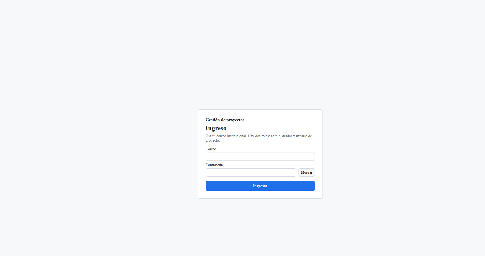

Con `ADMIN` el menú **Seguimiento** incluye **KPI**.

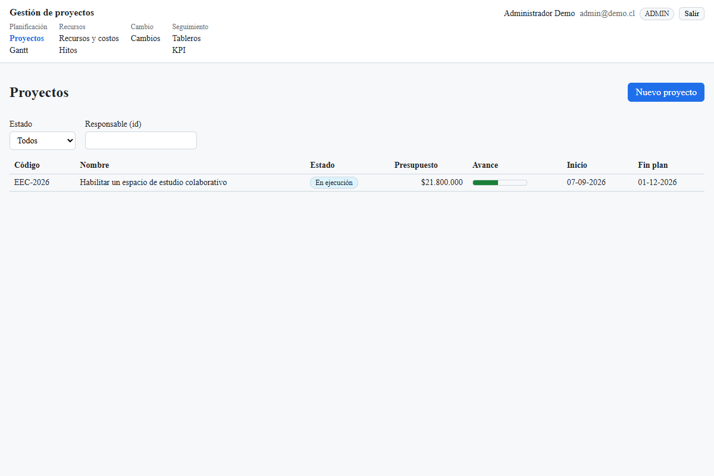

Con `USUARIO_PROYECTO` ese ítem no está. **Cambios** y **Tableros** siguen en el menú.

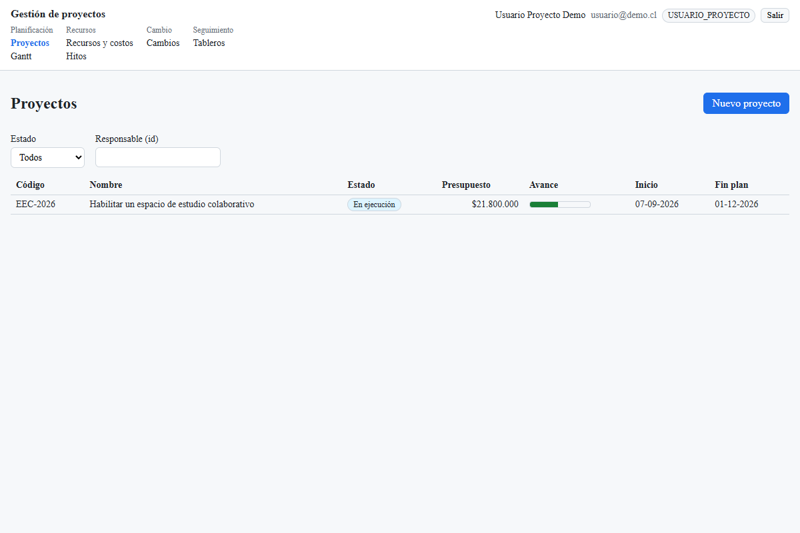

Si ese rol escribe la ruta `/kpi`, la pantalla dice **Acceso denegado**: «No tiene permiso para administrar los KPI.»

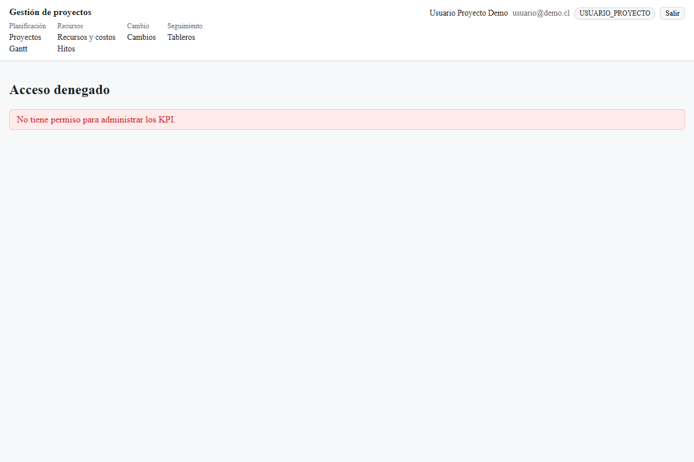

## Proyectos

**Proyectos** lista código, nombre, estado, presupuesto, avance, inicio y fin plan.
Los estados en pantalla son **Planificado**, **En ejecución**, **Suspendido** y **Terminado**.
El filtro **Estado** y el campo **Responsable (id)** reducen la lista.

1. Pulse **Nuevo proyecto**.
2. Complete **Código**, **Nombre**, **Estado**, **Responsable (id)**, **Presupuesto**, **Moneda** (tres letras, por ejemplo CLP) y **Fecha de inicio**.
3. Escriba la **Descripción** y marque los **Días laborales** (Lun a Dom). Hace falta al menos un día.
4. Pulse **Guardar**. Sin fecha de inicio la pantalla avisa que no se calculan las fechas de las tareas.

Para abrir uno, pulse su fila. **← Proyectos** vuelve al listado.

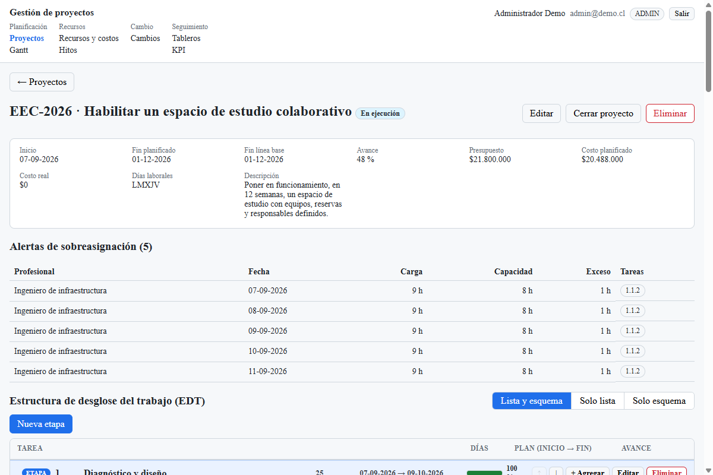

En un proyecto que no está terminado:

- **Editar** abre el mismo formulario y guarda los cambios.
- **Cerrar proyecto** pide confirmación. Al confirmar queda **Terminado** y ya no se puede modificar.
- **Eliminar** pide confirmación y borra el proyecto con su EDT. Solo se completa si el estado es **Planificado**. En otro estado la pantalla muestra el mensaje del sistema: solo se pueden eliminar proyectos en estado Planificado.

La ficha también muestra inicio, fin planificado, fin de línea base, avance, presupuesto, costo planificado, costo real y días laborales.
**Alertas de sobreasignación** lista profesional, fecha, carga, capacidad, exceso y tareas. La misma marca se explica en Recursos y en el Gantt.

## EDT

Dentro del proyecto, **Estructura de desglose del trabajo (EDT)** tiene tres vistas: **Lista y esquema**, **Solo lista** y **Solo esquema**.

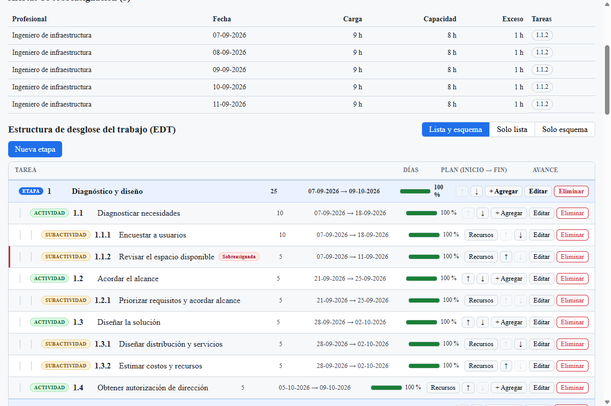

La lista muestra el tipo (**Etapa**, **Actividad**, **Subactividad**), el código, el nombre, los días, el plan (inicio → fin) y el avance.
Los códigos salen solos: `1`, `1.1`, `1.1.1`.

1. **Nueva etapa** crea el primer nivel. El formulario pide **Nombre**, **Responsable (id)** y **Descripción**. Pulse **Guardar**.
2. En una etapa o actividad, **+ Agregar** crea el nivel siguiente. El título del formulario indica el padre, por ejemplo «Nueva subtarea de 1.1».
3. En una subactividad (o en una actividad sin hijos) el formulario también pide **Duración (días hábiles, 0 = hito)** y **Avance (%)**.
4. **Editar** cambia ese nodo. **↑** y **↓** lo suben o bajan entre sus hermanos. **Eliminar** pide confirmación; si tiene hijos, también se eliminan, y los códigos siguientes se renumeran.
5. En una tarea sin hijos, **Recursos** abre las asignaciones de esa tarea (cantidad, tarifa, costo). El detalle del formulario está en la sección de recursos.

En un nodo con hijos la pantalla avisa: duración, fechas y avance se calculan desde sus subtareas. Esos campos no se editan en el padre.

Si la tarea está sobreasignada, la fila lleva la marca **Sobreasignada**.

## Dependencias

Al final de la ficha del proyecto está **Dependencias**. Relacionan tareas sin hijos.

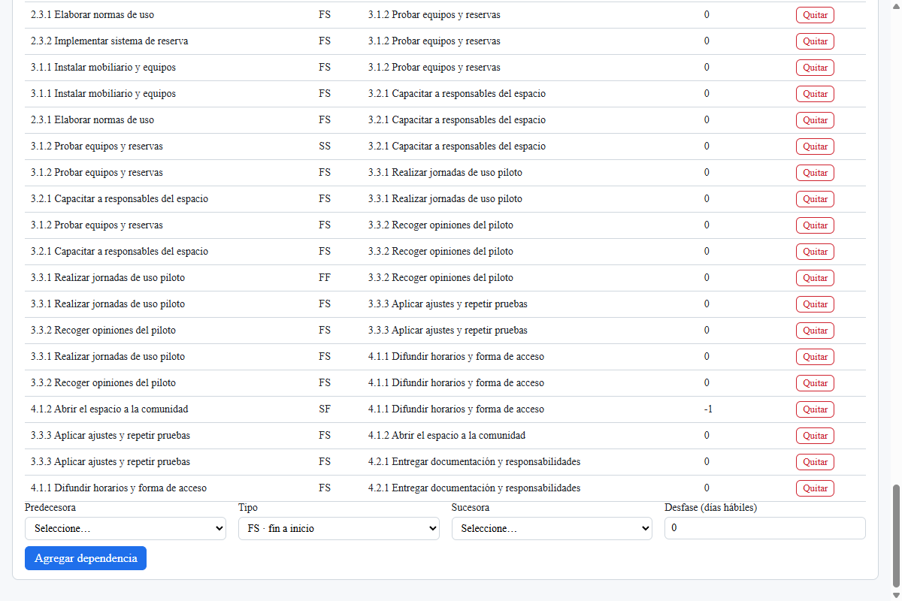

1. Elija **Predecesora** y **Sucesora**.
2. Elija el **Tipo**: **FS · fin a inicio**, **SS · inicio a inicio**, **FF · fin a fin** o **SF · inicio a fin**.
3. Indique el **Desfase (días hábiles)**. Puede ser negativo.
4. Pulse **Agregar dependencia**.

La tabla muestra predecesora, tipo, sucesora, desfase y **Quitar**.
Si el enlace forma un ciclo, la pantalla muestra el mensaje del sistema y no guarda el enlace.
Al agregar o quitar, las fechas se vuelven a calcular y la pantalla lista las que se movieron.

En el Gantt, el panel de la tarea también muestra sus dependencias, con **Guardar** y **Quitar**.

## Recursos y costos

Abra **Recursos y costos**.

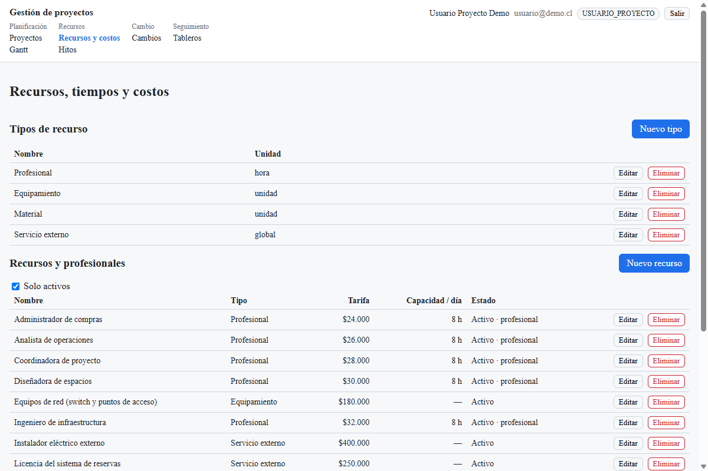

**Tipos de recurso.** **Nuevo tipo** pide nombre y unidad. **Editar** y **Eliminar** actúan sobre la fila.

**Recursos y profesionales.** **Nuevo recurso** pide **Tipo**, **Nombre**, **Tarifa (CLP)** y, si es profesional, **Capacidad diaria (horas)**.
**Solo activos** oculta los inactivos. **Editar** cambia la ficha.
**Eliminar** pide confirmación: si el recurso ya está asignado a una tarea, solo se desactiva.

**Asignar un recurso a una tarea.** En la EDT pulse **Recursos** en la tarea sin hijos, o ábrala en el Gantt y use el mismo panel.

1. Pulse **Asignar recurso**.
2. Elija **Recurso**, **Cantidad (horas si es profesional)** y, si quiere otra, **Tarifa**. Vacía, usa la tarifa del catálogo.
3. **Horas por semana** y **Semanas** son opcionales.
4. Pulse **Guardar asignación**.

En un profesional la cantidad son las horas totales de la tarea. El recálculo reparte esa carga en los días hábiles.
El panel muestra **Costo planificado de la tarea** y **Costo real de la tarea**. La pantalla indica que el costo planificado es cantidad × tarifa, y que el costo real queda en cero mientras no haya ejecución.
**Editar** y **Quitar** cambian o sacan la fila. Al guardar, el plan se recalcula.

**Sobreasignación por proyecto.** Elija el proyecto. La tabla muestra profesional, fecha, carga, capacidad, exceso y tareas.
Si nadie supera su capacidad, la pantalla lo dice.

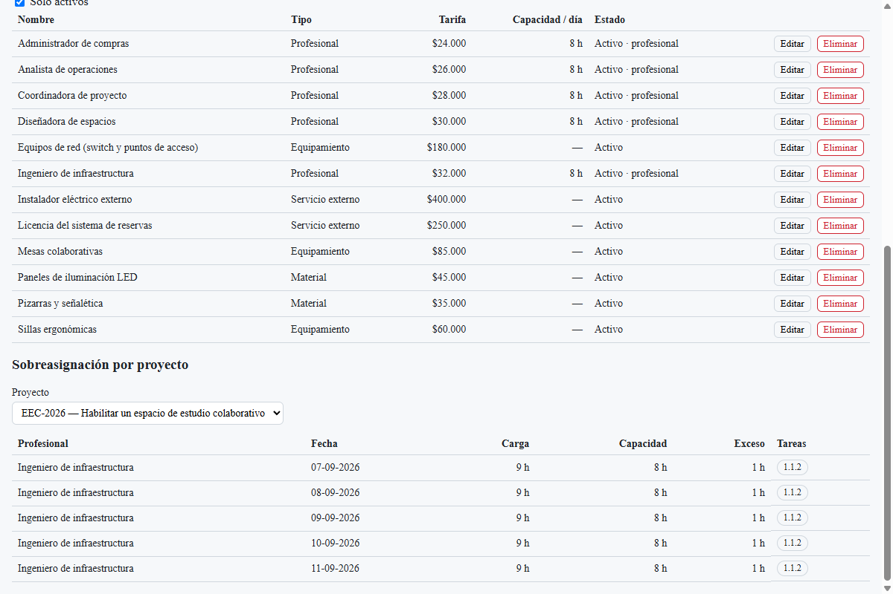

La misma situación se marca **Sobreasignada** en la EDT y en el panel del Gantt, y **SA** en la lista del diagrama.

## Gantt

Abra **Gantt** y elija el proyecto. Sin proyecto, la pantalla pide elegirlo.

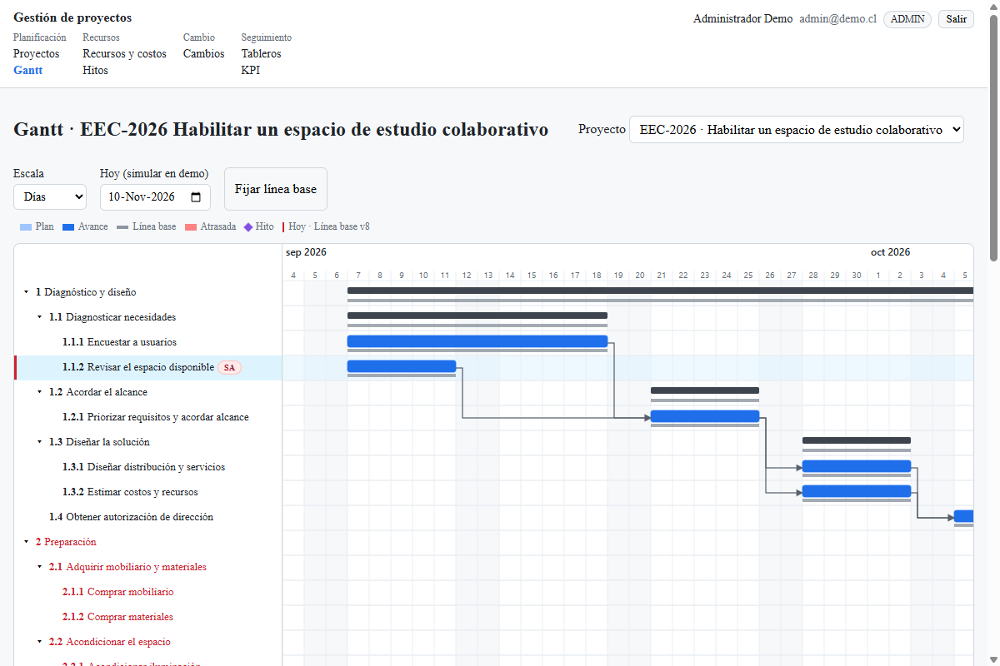

- **Escala**: **Días** o **Semanas**.
- **Hoy (simular en demo)**: mueve la línea de hoy.
- **Fijar línea base**: guarda el plan vigente como línea base. No está en un proyecto **Terminado**.
- La leyenda es **Plan**, **Avance**, **Línea base**, **Atrasada**, **Hito** y **Hoy**. Si ya hay base, indica la versión.
- **▾** / **▸** pliega o expande una etapa o actividad. Pulse el nombre de una fila para abrir su panel.

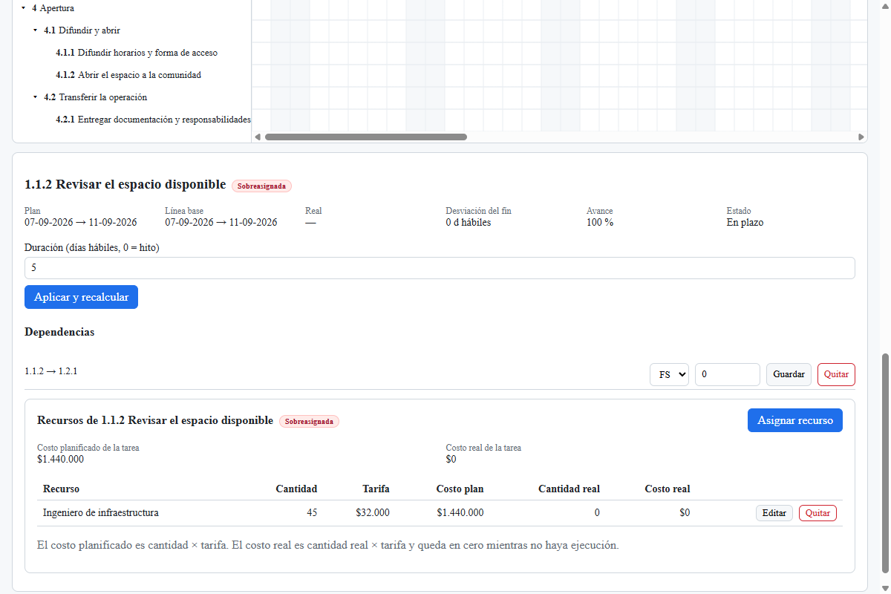

El panel muestra plan, línea base, real, desviación del fin, avance y estado (**En plazo** o **Atrasada**).
Si la tarea está marcada, el título lleva **Sobreasignada**.

1. En una tarea sin hijos, cambie **Duración (días hábiles, 0 = hito)**.
2. Pulse **Aplicar y recalcular**. Se mueven las fechas que dependen de esa duración y se actualizan costos y KPI.
3. En **Dependencias**, cambie el tipo o el desfase y pulse **Guardar**, o pulse **Quitar**.
4. En **Recursos de…**, use **Asignar recurso**, **Editar** o **Quitar**, igual que en la EDT.

En una etapa o actividad con hijos el panel avisa: las fechas se calculan desde sus subtareas. Ahí no está **Aplicar y recalcular**.

## Hitos

Abra **Hitos**. La pantalla aclara que un hito es un logro verificable de duración cero y no es una tarea de la carta Gantt.

1. Elija el **Proyecto**.
2. Pulse **Nuevo hito**.
3. Complete **Código**, **Logro verificable**, **Semana prevista** y **Estado** (**Pendiente**, **Cumplido** o **No cumplido**).
4. Si corresponde, indique **Fecha real**, **Evidencia y fuente de datos**, **Indicador / forma de cálculo**, **Unidad y criterio de aceptación**, **Quién valida y cuándo** y **Acción si no se cumple**.
5. En **Actividades asociadas**, marque las actividades del proyecto. Cada una muestra su término.
6. Pulse **Guardar**. Si la fecha prevista o la fecha real quedan antes de ese término, la pantalla lo dice y no guarda. Para **Cumplido** hacen falta evidencia y fecha real.

**Editar** abre el mismo formulario. Desde ahí, **Eliminar** borra el hito y sus actividades asociadas, previa confirmación.

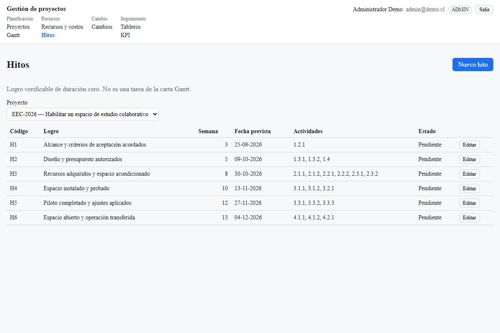

## KPI

Solo `ADMIN` ve **KPI** en el menú. `USUARIO_PROYECTO` no administra definiciones; los valores ya calculados los lee en **Tableros**.

1. Abra **KPI** y elija el **Proyecto**.
2. La tabla muestra código, nombre, categoría (**Proyecto**, **Hitos** o **Cambio**), alcance (**Global** o **Proyecto**), estado (**Activo** / **Inactivo**) y **Semáforo**.
3. **Ver** abre la ficha y el último valor. **Editar** cambia la definición. **Activar** o **Desactivar** cambian el estado.
4. **Nuevo KPI** abre el alta. Use los botones de **Variables permitidas** para insertar un nombre del catálogo en **Fórmula**. Esos nombres están en [`api/kpi-variables.md`](api/kpi-variables.md): con categoría **Proyecto** o **Hitos** salen las de proyecto e hitos; con **Cambio**, las de gestión del cambio. No hay otros nombres.
5. Pulse **Guardar**.

En `/kpi` no hay un botón **Calcular**. El valor y el semáforo se actualizan cuando el proyecto se recalcula, por ejemplo con **Aplicar y recalcular** en el Gantt o al guardar una asignación.
Activar o desactivar no recalcula: el semáforo es el del último snapshot.
Si el proyecto está cerrado, se pueden editar los KPI globales, no los de ese proyecto.

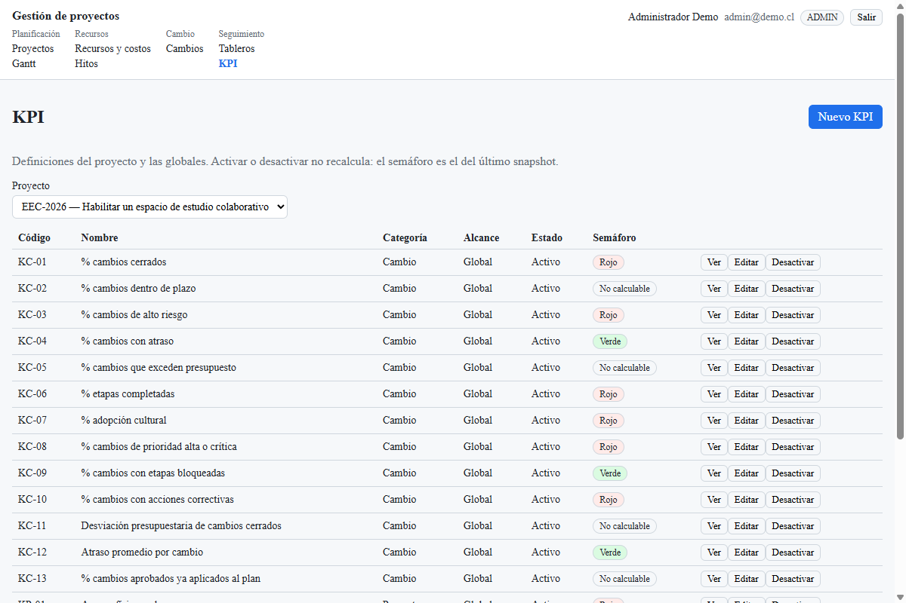

Más abajo en la misma tabla están los KPI de proyecto e hitos (KP-01 a KP-08).

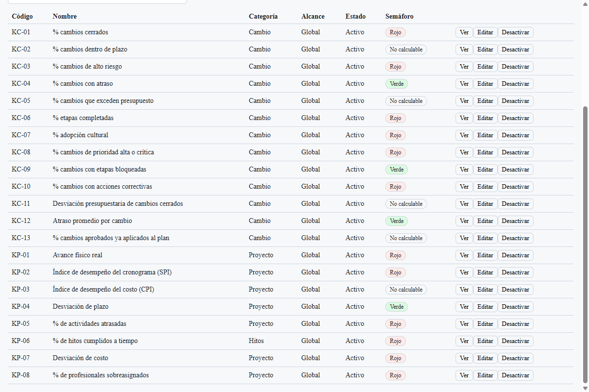

El alta muestra el catálogo como botones. Pulsar uno inserta ese nombre.

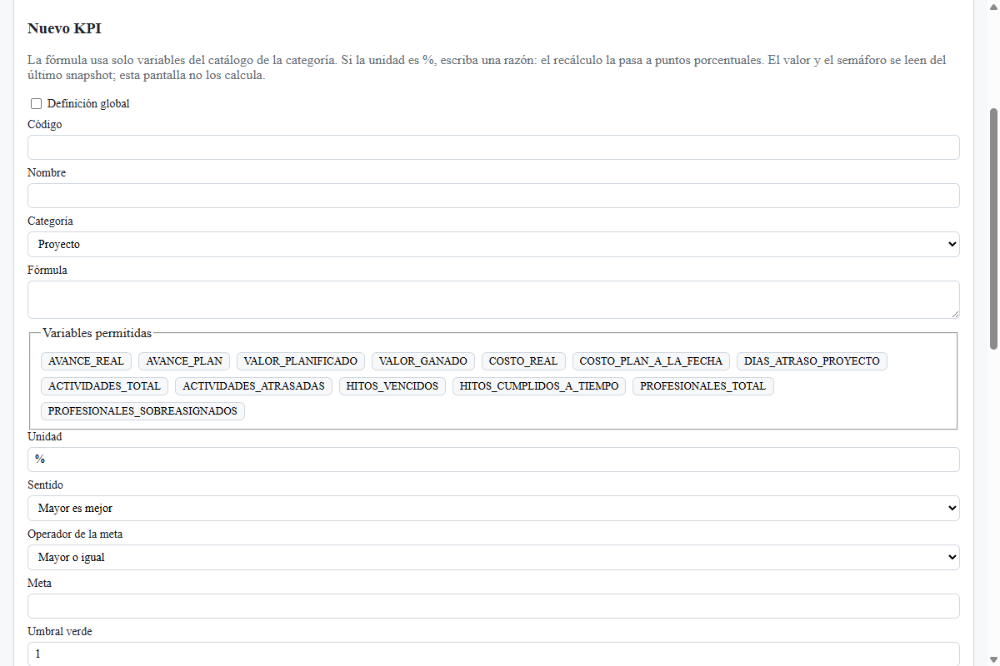
