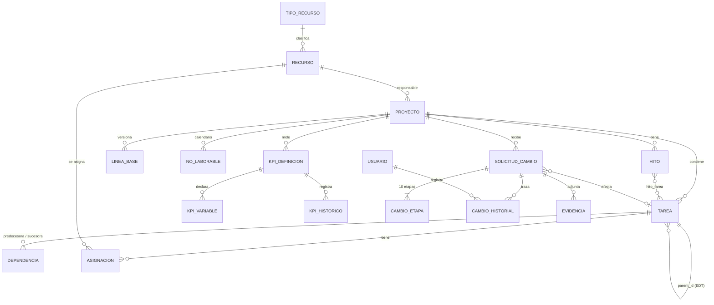

# Modelo de datos

Fuente de verdad: `backend/src/main/resources/db/migration/` (V1 base, V20 y V21 de Dev A, V22 de la línea base; B usa V30+ y C V40+).
Este documento describe el esquema resultante de aplicar todas las migraciones, verificado en PostgreSQL 16. Las entidades JPA se validan contra
él al arrancar (`ddl-auto: validate`), así que cualquier diferencia hace fallar el backend.

## Diagrama entidad-relación

## Tablas por módulo

### Proyectos y EDT (Dev A)
| Tabla | Contenido | Claves y restricciones |
|---|---|---|
| `proyecto` | Código, nombre, estado (`PLANIFICADO`, `EN_EJECUCION`, `SUSPENDIDO`, `TERMINADO`), responsable, presupuesto, moneda, días laborales (letras `LMXJV`), fechas plan / base / real y totales consolidados (avance, costo plan, costo real) | `codigo` único; avance 0–100; presupuesto ≥ 0; `responsable_id` → `recurso` |
| `tarea` | Nodo de la EDT: `ETAPA`, `ACTIVIDAD` o `SUBACTIVIDAD`, con código jerárquico (1, 1.1, 1.1.1), duración en días hábiles, fechas plan / base / real, avance y costos plan / real / base | `(proyecto_id, codigo)` único; `parent_id` → `tarea` (cascada); la etapa no tiene padre y las demás sí; duración ≥ 0; avance 0–100 |
| `dependencia` | Precedencia entre dos tareas: tipo `FS`, `SS`, `FF` o `SF` y desfase en días hábiles (puede ser negativo) | `(predecesora_id, sucesora_id)` único; predecesora ≠ sucesora; ambas con borrado en cascada |
| `linea_base` | Versiones de la línea base: motivo, fecha, fecha de fin y costo total en ese momento | `(proyecto_id, version)` único |
| `no_laborable` | Días no laborables del calendario (globales con `proyecto_id` nulo, o de un proyecto) | `(proyecto_id, fecha)` único |

### Recursos, costos e hitos (Dev B)
| Tabla | Contenido | Claves y restricciones |
|---|---|---|
| `tipo_recurso` | Tipos (4 en el caso mínimo) y unidad | `nombre` único |
| `recurso` | Profesionales y otros recursos: tarifa, capacidad diaria, especialidad, categoría, horas por semana, cantidad requerida | tarifa ≥ 0; horas por semana 0–168 |
| `asignacion` | Recurso asignado a una tarea: cantidad, tarifa, horas por semana, semanas, costo plan y real | `(tarea_id, recurso_id)` único; cantidad > 0 |
| `hito` | Logro verificable con fecha plan / base / real, estado (`PENDIENTE`, `CUMPLIDO`, `NO_CUMPLIDO`), evidencia, indicador, criterio de aceptación, validador y acción si no se cumple | `(proyecto_id, codigo)` único |
| `hito_tarea` | Actividades de las que depende cada hito | clave `(hito_id, tarea_id)` |
| `kpi_definicion` | KPI configurable: categoría (`PROYECTO`, `HITOS`, `CAMBIO`), ámbito, fórmula, unidad, sentido, operador y meta, umbrales, periodicidad, fuente | código único por proyecto (o global si `proyecto_id` es nulo) |
| `kpi_variable` | Variables que usa la fórmula | `(kpi_id, nombre)` único |
| `kpi_historico` | Valor, cumplimiento y semáforo en cada recálculo | índice `(kpi_id, calculado_en)` |

### Gestión del cambio y acceso (Dev C)
| Tabla | Contenido | Claves y restricciones |
|---|---|---|
| `solicitud_cambio` | Solicitud con tipo (`ALCANCE`, `TIEMPO`, `COSTO`, `RECURSO`, `TECNOLOGIA`, `ORGANIZACION`), estado (`ABIERTO`, `EN_EVALUACION`, `APROBADO`, `RECHAZADO`, `EN_IMPLEMENTACION`, `CERRADO`), prioridad, riesgo, impacto (días, costo, alcance, recursos), presupuesto previsto, costo real, resultado de la evaluación y bandera `aplicada` | `(proyecto_id, codigo)` único; tarea afectada opcional |
| `cambio_etapa` | Las 10 etapas del cambio y su estado (`PENDIENTE`, `EN_CURSO`, `COMPLETADO`, `BLOQUEADO`, `NO_APLICA`) | `(solicitud_id, numero)` único; número 1–10 |
| `cambio_historial` | Bitácora de cada modificación (campo, valor anterior y nuevo, usuario) | índice `(solicitud_id, fecha)` |
| `evidencia` | Evidencias de la solicitud (descripción y URL) | borrado en cascada |
| `usuario` | Usuarios del sistema con rol `ADMIN` o `USUARIO_PROYECTO` | `email` único |

## Reglas de integridad

**Las garantiza la base de datos**
- Una etapa no tiene padre; una actividad o subactividad siempre lo tiene (`tarea_check`).
- El código de una tarea es único dentro del proyecto.
- Una dependencia no puede unir una tarea consigo misma ni repetirse (mismo par).
- Todos los porcentajes están entre 0 y 100; duraciones, tarifas, presupuestos y cantidades no son negativos.
- Los estados, tipos, prioridades y roles solo admiten los valores listados (restricciones `CHECK`).
- Borrado en cascada: al eliminar un proyecto se van sus tareas, dependencias, línea base, hitos, KPI y solicitudes; al eliminar una tarea se van sus hijos, dependencias y asignaciones. Una tarea referenciada por una solicitud de cambio no se puede eliminar (el servicio responde `TAREA_REFERENCIADA`).
- Cada versión de la línea base es única por proyecto.

**Las garantiza el servicio (no se pueden expresar solo con restricciones)**
- Un ciclo de dependencias se rechaza con `409 CICLO_EN_DEPENDENCIAS`; la transacción se deshace y no cambia ninguna fecha.
- Las dependencias solo existen entre tareas sin subtareas; una tarea con dependencias no recibe hijos (`TAREA_CON_DEPENDENCIAS`) y viceversa.
- Las dos tareas de una dependencia pertenecen al mismo proyecto.
- Una subactividad no puede tener hijos (`JERARQUIA_INVALIDA`); el tipo se deduce del padre.
- Un proyecto `TERMINADO` no se modifica (`PROYECTO_CERRADO`).
- Las columnas `*_base` de `tarea` y `proyecto` solo se escriben al fijar la línea base; el recálculo nunca las toca.
- Duración, fechas y avance de actividades y etapas se calculan desde sus hijos: no se editan a mano.
- Los totales del proyecto (avance, costo plan, costo real, fecha de fin) salen de las etapas, sin sumar dos veces los costos de padres e hijos.
- Una solicitud tiene 10 etapas y `aplicada` solo puede ser verdadera si el estado es `APROBADO` o posterior (a cargo de Dev C al implementar la gestión del cambio).
- Las asignaciones solo cuelgan de tareas sin hijos y la sobreasignación de un profesional genera alerta (a cargo de Dev B al implementar recursos).

## Cómo cambiar el modelo
Una migración nueva por cambio, con el prefijo del dueño (A: V20+, B: V30+, C: V40+); nunca se edita una ya publicada en `main`.
Al cambiar una tabla hay que actualizar también la entidad JPA, porque `ddl-auto: validate` rechaza cualquier diferencia de tipo.
