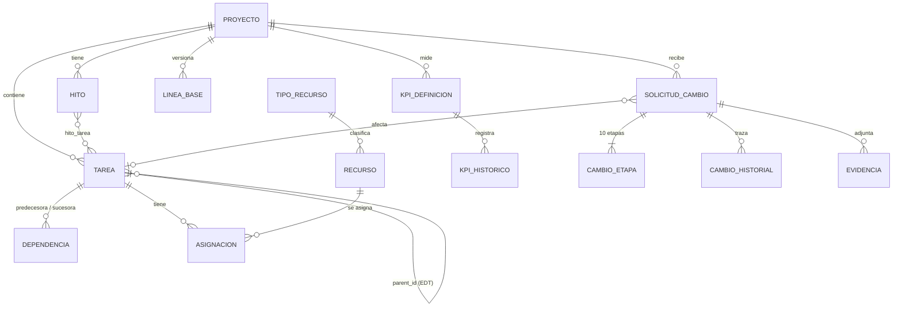

# Modelo de datos

La fuente de verdad es `backend/src/main/resources/db/migration/` (V1 es un borrador del Sprint 0, ver issue A-01).
Este documento se completa con el diagrama final (`db/diagramas/`) y las reglas de integridad.

## Reglas de integridad (a verificar)

- Una `ETAPA` no tiene padre; `ACTIVIDAD` y `SUBACTIVIDAD` sí. Código único por proyecto.
- Dependencias: predecesora distinta de sucesora, par único, tipo en {FS, SS, FF, SF}. Los ciclos se rechazan en la capa de servicio (el motor valida).
- Las asignaciones solo cuelgan de tareas hoja. Cantidad > 0.
- Avance entre 0 y 100. Línea base versionada: las columnas `*_base` solo se escriben al fijarla.
- Una solicitud tiene exactamente 10 etapas. `aplicada` solo puede ser verdadera si `aprobacion = APROBADA`.
